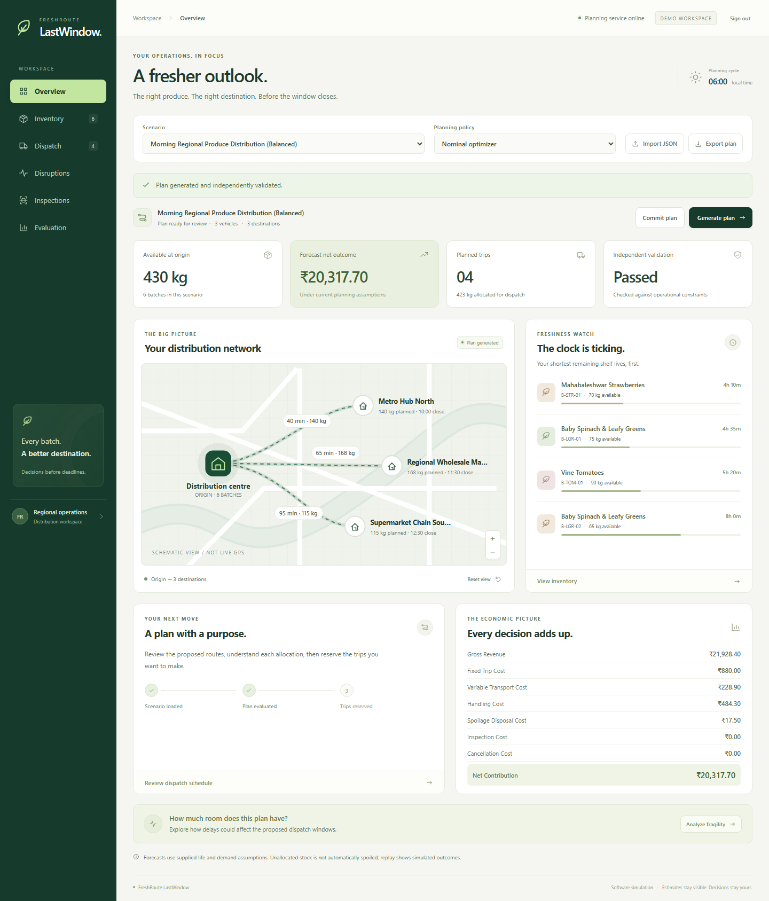
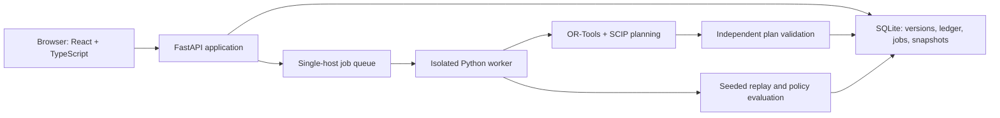

# FreshRoute: LastWindow


URL: https://lastwindow-production.up.railway.app
Workspace password: Q4ZpnHHgSTfBHN95p7anPwPxW6TMrebx
**make sure to use these to login to the project**

**Plan, explain, and recover fresh-produce deliveries before their opportunity closes.**

FreshRoute LastWindow is a software decision-support application for perishable produce distribution, built for PS03. It combines inventory, shelf-life estimates, receiving hours, demand, vehicle availability, and permitted price tiers into a proposed dispatch plan. Operators can inspect the reasoning, reserve resources, respond to delays, and compare simulated outcomes.

**[Open the live application](https://lastwindow-production.up.railway.app)** · **[Judge walkthrough](docs/judges-guide.md)** · **[Three-minute video](deliverables/LastWindow_Hackathon_3min.mp4)** · **[Video transcript](deliverables/LastWindow_Video_Script.md)**

## Judge access

No installation, account creation, hardware, or API key is needed to evaluate the hosted app.

| Field | Value |
|---|---|
| Live application | https://lastwindow-production.up.railway.app |
| Login ID / username / email | **Not required**; the app has a password-only sign-in form |
| Workspace password | Provided in the private judging packet / submission access notes |
| Access level | Shared operator access to the synthetic hackathon demo |
| First scenario | **Morning Regional Produce Distribution (Balanced)** |
| First planning policy | **Nominal optimizer** |

1. Open the live application in a current desktop or mobile browser.
2. Enter the password supplied with the submission in **Workspace password**.
3. Select **Sign in**. The default scenario loads automatically.
4. Select **Generate plan** and wait for **Plan generated and independently validated.**

The application demo password is supplied privately with the judging submission. It is not a GitHub, Railway, email, or personal-account password. No hosting-provider credentials are needed to evaluate the app. All visitors use the same editable demonstration workspace. Imports, reservations, delays, and inspections can affect the state another judge sees. Use the [reset instructions](#restore-a-clean-demonstration) when needed. This deployment contains synthetic sample data and is not a tenant-isolated production service.

## Contents

- [What the project solves](#what-the-project-solves)
- [Five-minute evaluation path](#five-minute-evaluation-path)
- [How to operate each screen](#how-to-operate-each-screen)
- [Restore a clean demonstration](#restore-a-clean-demonstration)
- [Understand the results](#understand-the-results)
- [Project gallery](#project-gallery)
- [Architecture and technologies](#architecture-and-technologies)
- [Run locally](#run-locally)
- [Configuration and deployment](#configuration-and-deployment)
- [Verification and evidence](#verification-and-evidence)
- [Troubleshooting](#troubleshooting)
- [Repository guide](#repository-guide)
- [Scope and limitations](#scope-and-limitations)

## What the project solves

Fresh-produce dispatch is a connected decision problem. The oldest batch is not always the best next shipment, the shortest route is not always the most valuable destination, and a delay can invalidate a previously feasible schedule. LastWindow helps operators examine these trade-offs together.

| Operational question | LastWindow capability |
|---|---|
| What should leave the warehouse next? | Generate batch allocations and a vehicle schedule under modeled constraints. |
| Which delivery opportunity is closing? | Inspect dispatch deadlines and the remaining departure slack. |
| Why was a batch allocated this way? | Open a decision receipt with explanations and supporting evidence. |
| What happens to stock already promised? | Reserve stock and vehicle intervals, then replan around existing commitments. |
| What should we do after a delay? | Observe the delay, examine conflicts, repair eligible reservations, and replan. |
| Is inspecting a batch worth the cost? | Rank simulated inspection opportunities, accounting for time and cost. |
| Will a plan still work when assumptions change? | Replay its saved snapshot and compare policies on shared simulated worlds. |

The distinctive workflow is the connection between **dispatch windows, explainable allocations, commitment-aware recovery, and evaluation under uncertainty**.

## Five-minute evaluation path

Start with a fresh default scenario. The timings below are a presentation guide; calculations depend on available server resources. Inspection ranking and policy comparison can take longer than a nominal plan.

| Step | Action | What to look for |
|---|---|---|
| 1. Plan | On **Overview**, choose **Nominal optimizer** and select **Generate plan**. | A generated schedule and independent validation result. |
| 2. Understand value | Review the overview cards and economic breakdown. | Available inventory, allocated quantity, planned trips, and forecast net contribution. |
| 3. Explain | Open **Inventory** and select **View receipt** for a batch. | Allocation reasoning, relevant constraints, and expandable evidence. |
| 4. Find urgency | Open **Dispatch** and review **Dispatch windows**. | Latest scheduled departure, slack, and eligibility or rejection reasons. |
| 5. Evaluate | Open **Evaluation** and select **Run replay**. | Simulated sales, expired unsold stock, carryover, service failures, and inventory reconciliation. |
| 6. Recover | Select **Commit plan**, then open **Disruptions**, record a route delay, and generate a revised plan. | Protected commitments and explicit conflicts when existing reservations no longer fit. |

For the complete recovery sequence, inspection workflow, and policy comparison, follow the [detailed judge guide](docs/judges-guide.md).

On the untouched normal demo, the verified nominal plan generated **4 trips**, allocated **423 kg from 430 kg**, and forecast **₹20,317.70 net contribution**. These are reference outputs for the supplied scenario and configuration, not promised operational results. Shared-workspace changes or a different policy can change them. Equivalent solver solutions can also differ in their arrangement.



## How to operate each screen

### Controls available across the workspace

- **Scenario:** switches between the supplied examples. Selecting a scenario loads its current operating state; it does not reset an existing scenario.
- **Planning policy:** selects Nominal optimizer, Uncertainty-aware selection, FEFO baseline, or Illustrative FIFO baseline. Select **Generate plan** after changing a policy to compute a new result.
- **Import JSON:** validates and imports a scenario package. Reusing an existing scenario ID creates a new version and replaces its active operating state.
- **Export plan:** downloads the current plan as JSON. Generate a plan first. This export is a planning result, not an importable scenario package.
- **Generate plan:** plans against the current scenario version and operating revision.
- **Commit plan:** reserves the eligible generated trips. It changes the operating state and makes the displayed plan historical.
- **Cancel operation:** appears during supported queued or running calculations. Cancelling a calculation does not undo a previously committed reservation or recorded event.
- **Sign out:** ends the browser session.

### Overview

Review the available stock, forecast contribution, trip count, and independent validation status. The distribution network shows modeled corridors and planned quantities; it is a schematic, not a live GPS map. Select a destination to focus it, use the zoom buttons, or select **Reset view**. The freshness watch highlights batches with short assumed remaining life. **Analyze fragility** opens computed evidence about the current plan.

### Inventory

Search by batch or commodity. Review available quantity and the assumed remaining-life interval. Generate a plan before selecting **View receipt**. In the receipt, read the explanation and constraints, then expand **Complete evidence** for the detailed record. Select **Close receipt** to return.

### Dispatch

Review the vehicle schedule, batch allocations, allowed prices, discounts, and departure windows. The schedule includes loading start, departure, ready-for-sale time, and vehicle release. The dispatch-window table reports the latest scheduled departure and slack. An **Unavailable** departure is not an approved shipment; read its accompanying reason.

### Disruptions

Select a **Route**, enter an integer number of additional delay minutes, and select **Apply delay**. The prior plan is now historical; generate a revised plan. Existing commitments retain their stock and vehicle locks.

If a reserved trip conflicts, eligible unstarted trips offer **Move reservation** or **Release**. Moving searches for a feasible later same-route slot. Releasing restores the reservation's availability and records the displayed cancellation fee. Loading and dispatched trips stay locked. Some disruptions cannot be repaired while preserving every constraint. **Compare recovery options** opens a computed comparison; it does not itself apply a repair.

### Inspections

Select **Rank inspections**, then review estimated value, cost, duration, and recommendation. **Simulate inspection** records a simulated observation, advances decision time, and records its cost. Generate a new plan using the updated state. This is a simulated quality-information workflow, not a physical inspection or a food-safety certification.

### Evaluation

**Run replay** evaluates the generated plan using its stored planning snapshot and a seeded simulated world. It reports sold quantity, expired unsold stock, unexpired carryover, realized simulated net contribution, and service failures. Check **Inventory reconciled: Yes**.

**Compare policies** runs the current scenario through multiple policies using two shared simulation worlds. Review mean simulated contribution, sold quantity, and spoilage, and expand the evidence to inspect the manifest. It can take longer than a single plan and is an exploratory synthetic comparison.

## Restore a clean demonstration

Reloading the browser, signing out, or reselecting the same scenario **does not reset saved operating state**.

1. Download the supplied [normal demo scenario](https://raw.githubusercontent.com/paarth293/Fresh-Route/deploy/railway/scenarios/demo/demo-normal-001.json) as a `.json` file. The repository copy is [here](scenarios/demo/demo-normal-001.json).
2. In the app, select **Import JSON** and choose that file.
3. Wait for **Scenario imported as a new version.**
4. Choose **Nominal optimizer**, then select **Generate plan**.

Importing resets the active state for that scenario ID for everyone using this shared workspace. Existing historical plans and snapshots remain stored, but plans from the old version cannot be committed against the new version. Coordinate resets if several judges are exploring simultaneously.

The [shortage](scenarios/demo/demo-shortage-002.json) and [delay](scenarios/demo/demo-delay-003.json) fixtures provide additional demonstrations. Use a scenario fixture for import, not an exported plan.

## Understand the results

| Term | Meaning |
|---|---|
| Forecast net contribution | The plan's modeled financial outcome under its planning assumptions, not measured field profit. |
| Latest scheduled departure | The latest modeled departure for the batch/destination opportunity under the applicable constraints. |
| Dispatch slack | The modeled margin between the planned departure and its latest allowed departure. |
| Independent validation | A separate check of the generated plan against modeled inventory, timing, capacity, freshness, and related constraints. |
| Historical plan | A result tied to an older scenario version or operating revision. Its saved snapshot remains usable for historical analysis. |
| Realized simulated net | The financial outcome of a replayed simulation, not a real-world observation. |
| Carryover | Unsold inventory that remains unexpired at the end of the simulated evaluation period. It is not automatically spoilage. |

Times such as `15m` are minutes relative to the scenario start; they are not minutes from the current wall clock. The planning-cycle display shows the scenario's decision time. Currency is displayed in rupees and stored as integer paise. Quantities are integer units interpreted as kilograms in this MVP.

## Project gallery

Download the [complete upload-ready image pack](deliverables/LastWindow_Project_Gallery.zip), or open the [individual images and captions](deliverables/project-gallery/README.md). The cover is AI-generated conceptual brand artwork. The seven feature images are unaltered browser screenshots from the working application, captured with an isolated synthetic demo database.

## Architecture and technologies



| Layer | Technology / role |
|---|---|
| Interface | React, TypeScript, Vite, HTML, and CSS |
| API and validation | Python 3.11, FastAPI, Pydantic |
| Optimization | Google OR-Tools with the SCIP mixed-integer solver |
| Persistence | SQLite transactions, scenario versions, operating revisions, saved snapshots |
| Background work | Persistent job records and isolated Python subprocess workers |
| Evaluation | Seeded simulation worlds and shared-world policy comparisons |
| Automated checks | Python unittest, Vitest, Playwright |
| Hosting | Railway, multi-stage Docker build, persistent `/data` volume |

FastAPI serves the compiled React interface and API from one origin. The application does not require an external language-model API. Its briefing capability is deterministic.

## Run locally

### Requirements

- Python **3.11**, 64-bit.
- Node.js **24 LTS** and npm. The frontend tools require Node 22.12+ or 24+; use Node 24 for consistency with the deployment.
- Internet access for the initial dependency installation.
- On Windows, the Microsoft Visual C++ runtime required by OR-Tools.

Clone this repository and run commands from its root. A local installation uses its own database, separate from the hosted demo.

### Windows PowerShell

```powershell
git clone https://github.com/paarth293/Fresh-Route.git
Set-Location Fresh-Route
git switch deploy/railway
py -3.11 -m venv .venv
.\.venv\Scripts\python.exe -m pip install -r backend/requirements.lock
Set-Location frontend
npm ci
Set-Location ..
.\scripts\start.ps1
```

The startup script runs the backend checks, builds the frontend, and starts the app at **http://127.0.0.1:8000**. API documentation is at **http://127.0.0.1:8000/docs**. Stop with Ctrl+C.

### Linux or macOS

```bash
git clone https://github.com/paarth293/Fresh-Route.git
cd Fresh-Route
git switch deploy/railway
python3.11 -m venv .venv
.venv/bin/python -m pip install -r backend/requirements.lock
cd frontend
npm ci
cd ..
bash scripts/start.sh
```

### Restart after an unchanged, verified build

Windows:

```powershell
.\.venv\Scripts\python.exe -m uvicorn app.main:app --app-dir backend --host 127.0.0.1 --port 8000
```

Linux or macOS:

```bash
.venv/bin/python -m uvicorn app.main:app --app-dir backend --host 127.0.0.1 --port 8000
```

Run `npm run build` from `frontend/` again after changing frontend source. Opening `frontend/dist/index.html` directly does not start the app; its API service must be running.

Local password protection is off unless `FRESHROUTE_OPERATOR_PASSWORD` is set. To enable it, set an application password of at least 12 characters in the process environment before starting the server. The hosted judge password is not automatically used by local installations. For local HTTP, leave `FRESHROUTE_SECURE_COOKIES` unset; Secure cookies require HTTPS.

## Configuration and deployment

| Variable | Purpose |
|---|---|
| `FRESHROUTE_DB_PATH` | SQLite path. Default locally: `data/freshroute.sqlite3`. Hosted image: `/data/freshroute.sqlite3`. |
| `FRESHROUTE_OPERATOR_PASSWORD` | Optional local shared-workspace password; required by the hosted image. Minimum 12 characters. |
| `FRESHROUTE_REQUIRE_AUTH` | `1` makes `scripts/serve.py` reject startup without a valid password. Enabled in the hosted image. |
| `FRESHROUTE_SECURE_COOKIES` | `1` forces Secure session cookies when HTTPS terminates at the hosting ingress. Enabled in the hosted image. |
| `FRESHROUTE_ALLOWED_ORIGINS` | Comma-separated browser origins. Hosted demo uses its exact public HTTPS origin. |
| `PORT` / `HOST` | Bind settings for `scripts/serve.py`; defaults are `8000` / `0.0.0.0`. Railway supplies `PORT`. |
| `FORWARDED_ALLOW_IPS` | Proxy addresses trusted by the deployment entrypoint; defaults to loopback. |

The application does not automatically load `.env.example`; set variables in the process environment or hosting service. The existing `scripts/start.ps1` and `scripts/start.sh` commands use their explicit local bind settings; `PORT` and `HOST` above apply to `scripts/serve.py`.

The hosted deployment uses **one replica, one API worker, and a 500 MB persistent volume**. The SQLite database and local queue are designed for one host. Future pushes to `deploy/railway` trigger a Railway deployment. See [deployment configuration](docs/deployment.md) and the [live verification report](reports/deployment.md).

Sessions expire after eight hours and are revoked on logout or server restart. Queued jobs resume on startup; interrupted running jobs require an explicit retry. A browser refresh does not erase saved database records, although the interface may need a new plan generated for display.

## Verification and evidence

| Evidence | Verified result |
|---|---|
| Baseline backend audit | 73 passing unit/integration tests, including mandatory T01–T24 |
| Frontend tests | 9 passing tests |
| Local browser workflows | 7 passing workflows, including password-protected planning |
| Supplied scenario checks | All 8 fixtures passed validation, solve, and nominal replay checks |
| Deployment authentication checks | 4 focused regression tests passed, including the subsequently added secure-cookie test |
| Hosted browser walkthrough | Login, native planning, receipt, replay, mobile layout, logout, and saved-plan retrieval passed |

These are recorded results for the tested build and inputs, not a guarantee for every possible input or future deployment. The baseline test count predates the additional deployment regression test.

Detailed records: [build audit](reports/build-verification.md), [UI redesign](reports/ui-redesign.md), [hosted checks](reports/cloud-deployment-verification.json), [benchmark summary](reports/benchmark_summary_v1.md), and [evaluation protocol](docs/evaluation-protocol.md).

### Reproduce checks on Windows

Stop any local server occupying port 8000 before running browser tests. Run these from the repository root:

```powershell
.\.venv\Scripts\python.exe -m pip check
.\.venv\Scripts\python.exe backend/tests/run_all_tests.py
.\.venv\Scripts\python.exe scripts/verify_scenarios.py
Set-Location frontend
npm run build
npm test
npx playwright install chromium
npm run test:e2e
npm run test:e2e:auth
Set-Location ..
.\.venv\Scripts\python.exe scripts/run_benchmarks.py --partition test --world-count 2
.\.venv\Scripts\python.exe scripts/verify_responsiveness.py
```

On Linux/macOS, use `.venv/bin/python` in place of `.\.venv\Scripts\python.exe` and `cd` in place of `Set-Location`. Browser tests use isolated databases in `work/`; benchmark comparisons use the supplied synthetic fixtures.

## Troubleshooting

| Symptom | What to do |
|---|---|
| A username or email seems to be missing | The app needs only the workspace password in [Judge access](#judge-access). |
| Incorrect password | Copy the password supplied with the submission without extra spaces. |
| Too many login attempts | Wait at least one minute before retrying; failed attempts are rate limited. |
| Returned to sign-in | Sign in again; the session may have expired or the service may have restarted. |
| Receipt, replay, or export is disabled | Generate a plan first. |
| A calculation is taking time | Wait for its job status; inspection ranking and policy comparison are more expensive. Use **Cancel operation** if appropriate. |
| The plan is historical or a revision conflict appears | Another action changed the state. Generate a new plan before committing. |
| Reservations conflict after a delay | Review Disruptions. Move or release eligible unstarted reservations, then replan. A conflict is not proof of a feasible repair. |
| Move or Release is disabled | The trip is no longer an eligible unstarted reservation, or another operation is running. |
| Results differ from the reference demo | Shared state or the policy may have changed. Reimport the original normal scenario to restore it. |
| A scenario upload fails | Use a valid scenario JSON under 5 MB; read the validation error. Do not upload an exported plan as a scenario. |
| Local app opens without data or API connection | Start the backend and use its HTTP URL; do not open the generated HTML file directly. |
| Local login succeeds but the session does not persist | On local HTTP, unset `FRESHROUTE_SECURE_COOKIES`; keep it enabled for hosted HTTPS. |

## Repository guide

| Location | Purpose |
|---|---|
| `frontend/src/` | React interface and API client |
| `backend/app/main.py` | FastAPI entry point and compiled frontend hosting |
| `backend/app/api/` | Scenario, job, planning, inspection, recovery, and evaluation endpoints |
| `backend/app/domain/` | Operating ledger and state transitions |
| `backend/app/planning/` | Candidate generation, optimization, baselines, deadlines, explanations, recovery |
| `backend/app/validation/` | Input validation and independent plan validation |
| `backend/app/simulation/` | Seeded worlds, replay, and simulated observations |
| `backend/app/persistence/` | SQLite transactions, versions, snapshots, and saved records |
| `backend/app/jobs/` | Background queue and subprocess workers |
| `backend/tests/`, `frontend/tests/` | Automated verification |
| `scenarios/`, `configs/` | Synthetic fixtures and planning configurations |
| `docs/judges-guide.md` | Detailed operating instructions for evaluation |
| `docs/demo-script.md` | Presenter walkthrough aligned with the current interface |
| `docs/data-contract.md`, `docs/scenario_package.schema.json` | Scenario format and validation reference |
| `reports/` | Recorded test, benchmark, UI, and deployment evidence |
| `deliverables/` | Three-minute video, captions, and transcript |
| `Dockerfile`, `railway.json`, `scripts/serve.py` | Hosted build and runtime configuration |

## Scope and limitations

- This is a functional software MVP using synthetic scenarios and uncertainty distributions. Real-world waste reduction, profitability, safety, and adoption require field validation.
- The solver is optimal only over its generated candidate set when it reports optimality. It does not establish a globally optimal unrestricted delivery schedule.
- The FIFO baseline is illustrative repository code, not an organizer-supplied or commercial benchmark.
- Inspected test fixtures are not an unseen holdout. Policy comparisons are exploratory synthetic evidence.
- Inspection observations are simulated. Their value estimates and the cold-chain model need empirical calibration and do not certify food safety.
- Existing loading or dispatched trips are not automatically repaired by a residual plan. Some disruptions have no feasible repair.
- The hosted app is a shared editable workspace. Separate user accounts, tenant isolation, distributed workers, real GPS/sensor feeds, and commercial integrations are outside this build.
- Replays preserve the original planning snapshot; their simulated outcomes should not be presented as field measurements.

For modeling details, see [assumptions](docs/assumptions.md), [implementation decisions](docs/decisions.md), and [evaluation protocol](docs/evaluation-protocol.md).
